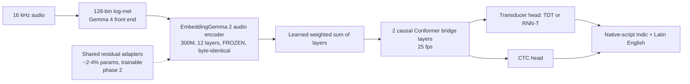

# Indic + English code-switching ASR on a frozen EmbeddingGemma 2 encoder: plan

Research plan, 23 October 2026, written before any GPU run. Kept as written; what actually ran is in training-recipe.md, pilot.md and full-run.md.

## Goal

One on-device dictation model, with no language picker, for:

- **Dravidian:** Tamil, Telugu, Kannada, Malayalam.
- **Indo-Aryan:** Hindi, Punjabi, Gujarati, Marathi, Bengali, Odia, Urdu.
- **English,** including Indian English.

Speech can switch language inside a sentence or between sentences: Kannada↔English, Hindi↔Kannada, Hinglish, Tanglish, and so on. Output follows how people type: **Indic words in native script, English words in Latin**.

## Evidence so far

**Frozen-encoder linear CTC probe** on FLEURS train → dev, about 7 h of training audio per language, best layer:

| Language | CER | WER | Result |
| --- | ---: | ---: | --- |
| English (reference) | 29.4% | 68.9% | Works (linear-CTC probe, `results/probe-en/`) |
| Kannada | 16.7% | 65.3% | Supported |
| Gujarati | 19.3% | 59.4% | Supported |
| Telugu | 22.3% | 74.7% | Supported |
| Hindi | 22.6% | 56.2% | Supported |
| Tamil | 23.6% | 75.7% | Supported |
| Malayalam, Punjabi, Marathi, Bengali, Odia, Urdu | probed (`results/probe-indic-2/`) | | |

- Probe WER is not the shipping WER. The large CER→WER gap in Dravidian languages comes from long words, which the decoder and tokenizer have to fix.
- w2v-BERT 2.0 (39.3% CER) and Parakeet v3 (18.2%) were probed on English only.

## Architecture (design A)

- **Encoder:** frozen. The hybrid adaptation comes only from added residual adapters, which ship as a separate file. Per-language adapter deltas are an option for later.
- **Decoder:** hybrid transducer-CTC, as in SraVaani (IISc) and IndicConformer. It doesn't invent text, can stream (the encoder has zero look-ahead), and gives a CTC fallback. Kept at 25 fps; 12.5 fps is too tight for CTC on Indic token rates.
- **Head-to-head in the pilot:** a small attention encoder-decoder trained on the same encoder outputs, to check whether it gives lower WER for completed recordings (it may hallucinate and cannot stream).
- **Tokenizer:** concatenated (aggregate) per-language SentencePiece. English about 1,024 tokens; each Indic language 512–1,024. Every token carries its language, which handles code-switching without language ID. The NeMo English–Hindi result supports this.
- **Decoding:** beam search, with optional per-language n-gram fusion for long Dravidian words.

## Data

Sampled hours per epoch, temperature sampling with α ≈ 0.5, Hindi capped. Sources are IndicVoices, Vaani, SPRING-INX, Kathbath, FLEURS, Common Voice, IISc-MILE and Shrutilipi (filtered by teacher CER). All are CC BY or CC0 unless flagged.

| Group | Hours per epoch |
| --- | --- |
| **Indo-Aryan** | Hindi 1,200; Marathi 700; Bengali 800; Punjabi 600; Gujarati 600; Odia 600; Urdu 500 real + ≤250 synthetic |
| **Dravidian** | Kannada 900 (priority); Tamil 900; Telugu 700; Malayalam 700 |
| **English** | LibriSpeech 500; People's Speech (CC BY only) 1,000; Common Voice en 600; VoxPopuli 300; Indian English: Vaani 22 h + ≥300 h licensed pseudo-labels or Indian-accent TTS |

**Code-switched data: about 15–20% of utterances.**

- **Real (about 6–8%):**
  - MUCS Hi-En 90 h and Bn-En 46 h (CC BY-SA, needs counsel review).
  - Code-mixed utterances mined from IndicVoices `[gloss]` and Vaani `{gloss}` markup, rewritten to Latin English.
- **Synthetic (about 10%, ≤12% of all hours):**
  - 50–100 h per X-English pair from word-level "speech collage" splicing plus LLM-written code-mixed text → TTS (IndicF5 MIT, IndicParler Apache-2.0).
  - Hi-Kn: 30–50 h of inter-sentential concatenation plus TTS.
  - Synthetic data adds to real data and never replaces it. Monolingual WER is tracked for regressions.

**Data-poor:** Urdu, Indian English, and every code-switched pair except Hi-En.

### Data loaders: implemented vs blocked (24 October 2026)

Details are in [data-licenses.md](data-licenses.md); the code is in `indicear/{sources,markup,ingest,stream,mixture}.py`.

- **Implemented** and tested on CPU with synthetic shards that mimic the verified schemas:
  - a source registry with pinned revisions;
  - per-source markup handling;
  - the download path: resumable, disk-guarded, parallel decode to 16 kHz FLAC;
  - the **streaming** training path: per-(source, language) streams, temperature interleave with a Hindi cap, a shuffle buffer, duration-bucketed batches, a 40 GiB rolling shard cache, and exact resume;
  - a speaker-disjoint dev set and eval-leak checks;
  - `word_langs` for LID;
  - the `pilot` and `full` mixture configs;
  - `ablate prep --mixture pilot|full [--stream]`.
- **Code-switched data is plentiful.**
  - IndicVoices' `[gloss]` convention is real: it lives in `unsanitized_normalized`, and 50–71% of hi/kn/ta rows are code-mixed.
  - Vaani's `{gloss}` is confirmed on HF rows.
  - MUCS and SPRING-INX write English in Latin.
- **Gated on review:** MUCS (CC BY-SA) and SPRING-INX (licence unconfirmed) are eval-only until `--allow-review`.
- **Blocked or excluded:**
  - Common Voice (Mozilla Data Collective terms), so the full mixture lacks its 600 h of English;
  - IndicTTS (licence unreadable);
  - Shrutilipi rows: the file listing works, but reading a parquet file returns 403 because the account is not on the gated repo's authorized list (24 October 2026).
- **Unblocked:** Vaani-transcription-part. Access came through on 24 October; the pilot streamed it, and a pilot shard has exactly the card's columns.
- **Done since (24 October 2026):** live streaming training (`ablate train --lower live`) with GPU augmentation, the script-normalised WER, evaluation on every fixed eval set, and the baselines runner. See "Pilot procedure" below.
- **Done for the full run (24 October 2026):** warm start from a finished run (`--init-from`) with tokenizer extension and head expansion, warm-start LR options, the `full_warm` mixture with stream weights and disjoint code-mixed pools, the Kathbath loanword normaliser, real-RIR support in the GPU augmentation, prep packs and `scripts/full_warm.sh`. See "Full warm-started run" below.
- **Not done:**
  - the Shrutilipi teacher-CER filter;
  - the synthetic Kn-En code-switch set;
  - the Indic DiarBench segmentation.
- **Changed from the original plan:**
  - IndicVoices valid shares nearly all its speakers with train. Using it as a held-out code-mixed eval set removes 12–25% of the train hours.
  - IndicVoices has no public test split.

## Evaluation (held out, speaker-disjoint)

- **Monolingual:**
  - Kathbath test-known / test-unknown / noisy;
  - FLEURS test (12 languages);
  - IndicVoices valid/test and SPRING-INX test;
  - Lahaja (hi);
  - Svarah and VoxPopuli accented (en-IN);
  - LibriSpeech test-clean / test-other.
- **Code-switched:** MUCS test + blind (Hi-En, Bn-En) and Vaani Benchmark (hi).
- **Build ourselves:** Kn-En, Hi-Kn, Ta-En, Te-En, Gu-En, Ml-En, Mr-En, Pa-En, Or-En, Ur-En and Indian-English dictation.
  - ≥2 h and 30–40 unseen speakers each.
  - Seeded from speaker-disjoint code-mixed IndicVoices/Vaani utterances, then rechecked by native annotators.
- **Metrics:**
  - WER and CER.
  - Script-normalised WER: Latin and native-script spellings of the same English word both count as correct. It uses the native forms the loaders store; there is no transliteration.
  - Script error rate.
  - Code-switch span accuracy on real code-mixed rows and on the synthetic set.
  - LID accuracy and language-span accuracy.
  - The definitions are in framework.md, "Metrics".
- **Baselines** on the same sets:
  - Run by `indicear.baselines`: IndicConformer 600M (CTC and RNN-T, hi/ta/kn) and the EmbeddingGemma 2 community models with a runnable card. That means ep-hindi-asr (unverified code), Dulu Malayalam and KothaGemma, the last two only when ml or bn rows are evaluated.
  - Not yet wired at the time: SraVaani-1.0, Koyal and Nemotron 3.5 (SraVaani was run later; see `docs/full-run.md`).

## Pilot procedure (as planned before the run)

1. **Launch.** `bash scripts/pilot.sh` on one A100 queues six resumable stages: setup → prep → train → eval → baselines → report. Each stage writes a DONE/FAILED marker and a GPU sampler log. Rerunning the script resumes. `SMOKE=1` runs the whole chain on a CPU.
2. **Prep.** `ablate prep --mixture pilot --stream` downloads only the fixed sets: eval, dev and FLEURS dev. The training audio streams.
   - MUCS stays eval-only unless `ALLOW_REVIEW=mucs`. Without it the pilot trains on 620 h instead of 650.
3. **Train.** `ablate train --lower live --variants v2,v3,v4,v4+lid --train-hours 6500` (650 h × 10 epochs).
   - All four variants train in one process from one stream, so audio decoding and encoder layers 1–6 run once per batch.
   - Hours become steps once the VRAM autotune fixes the frame budget (an assumed 85% packing). The estimate is logged, and each result reports the hours actually trained.
   - On-the-fly augmentation: half the rows are clean. The rest get one of noise (5–20 dB), babble (5–20 dB), reverb (RT60 0.3–0.9 s) with or without point noise, speed 0.9/1.1, or tel8k, all on the GPU. Codecs run on 15% of clips in the CPU workers.
   - Every corruption is deterministic from the stream state, so a resumed run reproduces it.
   - This replaces the phase-1 plan of training decoders on a layer-6 cache: the pilot trains adapters and heads on streamed audio.
4. **Eval.** `ablate eval` covers:
   - IndicVoices valid (hi, ta, kn);
   - Kathbath test-known/unknown, clean and noisy (hi, ta, kn);
   - Svarah;
   - IndicContextEval hi, full and code-mixed rows;
   - MUCS test and blind;
   - Vaani test, Lahaja, Vaani Benchmark, LibriSpeech and VoxPopuli;
   - FLEURS dev;
   - a reverberation and noise robustness subset.

   Results go to `results/<variant>/<set>.json`.
5. **Baselines.** `scripts/baselines.sh` runs in its own uv environment. Results go to `results/<system>/<set>.json` and `results/baselines.json`, which records what ran and what was skipped.
6. **Report.** `ablate report` writes `results/eval_summary.md`, one table across variants and baselines.

**Compute estimate (unverified).** About 18–26 A100-hours for training, plus under 2 A100-hours for eval and baselines. At about 7 units per hour that is about 130–190 units against a balance of about 196, so check the balance before launching. `TRAIN_HOURS=3250` halves training. The derivation is in framework.md, "Pilot compute estimate".

## Full warm-started run (as planned on 24 October 2026)

Phase 3, sized to 10–12 GPU-hours of training on one Colab G4 (RTX PRO 6000 Blackwell, 96 GB, 48 vCPU) or A100. Launch, settings and mechanics are in framework.md, "The full warm-started run".

- **Start:** the finished pilot `v4+lid` (step 7,423, config `34ad89478fc81611`). A warm start, not a resume: new config hash, step 0, fresh optimizer and schedule.
- **Copied from the pilot:** adapters, phonetic heads, LID heads, final LayerNorm, and the output rows of deva, latn, taml and knda, whose SentencePiece models are kept unchanged. beng, guru, gujr, orya, telu, mlym and arab get new models trained on the full mixture's text, and fresh output rows.
- **Check:** on 48 real pilot dev utterances, the expanded model's outputs for blank and the kept scripts are bit-identical with copied class rows, and within 1.9e-6 nats with the default fresh new-script classes (the pilot gave those scripts at most 4.1e-7 probability); greedy transcripts are identical.
- **Training:** peak LR 6e-4 after a 300-step warmup, cosine to 5e-5; new-script rows at 3× LR; phonetic CTC weight 0.15 (pilot 0.3); frame LID weight 0.2 (pilot 0.1); reverb 30% and reverb + point noise 17.5% of augmented rows; a 3 h shuffle buffer.

### Mixture and expected hours

`indicear/mixtures/full_warm.json`, about 5,500 h of pools. Shares of drawn rows are pinned: new languages 65% (bn, te, ml 9% each; pa 8%; mr, gu, or, ur 7.5%), refresher hi 4.5%, ta 5%, kn 6.5%, en 4%, code-mixed-only streams 15%, plus 2% non-speech negatives. Kathbath has double weight inside each new language (1.5 in hi, ta, kn).

Expected hours processed at `TRAIN_HOURS=8000` (`python -m indicear.mixture hours`; row shares × mean row durations, with the pilot's dev means and the new languages assumed to match):

| Language | IndicVoices | Kathbath | Vaani | Code-mixed only | Total | Share |
| --- | ---: | ---: | ---: | ---: | ---: | ---: |
| te | 309 | 277 | 83 | 122 | 792 | 9.9% |
| bn | 378 | 204 | 93 | 106 | 781 | 9.8% |
| ml | 363 | 304 | 22 | 83 | 772 | 9.7% |
| pa | 341 | 265 | 10 | 83 | 700 | 8.7% |
| ur | 406 | 182 | – | 83 | 672 | 8.4% |
| mr | 286 | 256 | 28 | 99 | 669 | 8.4% |
| or | 373 | 179 | 27 | 83 | 663 | 8.3% |
| gu | 322 | 247 | 9 | 83 | 661 | 8.3% |
| kn | 159 | 282 | 43 | 132 | 617 | 7.7% |
| hi | 183 | 125 | 70 | 238 | 615 | 7.7% |
| ta | 140 | 204 | 7 | 74 | 425 | 5.3% |
| en | LibriSpeech 247, People's Speech 187, VoxPopuli 93, Vaani 11 | | | | 538 | 6.7% |
| negatives | | | | | 96 | 1.2% |

- **By group:** new languages about 62% of the hours, the hi/ta/kn/en refresher (without its code-mixed streams) 21.9%, code-mixed-only streams 14.8% (the IndicVoices main streams are code-mixed in half or more of their rows too).
- **Read speech:** Kathbath is 2,526 h, 32% of the run (the pilot: about 13%).
- **Repetition:** most IndicVoices and Vaani pools are read about once; Kathbath pools 1.0–2.4 times; LibriSpeech and People's Speech about 2 times.

### Compute and cost (estimates)

| | G4 (RTX PRO 6000, 96 GB) | A100 80 GB |
| --- | ---: | ---: |
| `TRAIN_HOURS` (launcher default) | 8,000 | 7,000 |
| Frame budget (autotuned) | about 75–81k (estimate: the pilot's 67,045 scaled by VRAM, less for the 2× larger vocabulary) | about 64–67k |
| Steps at packing 0.75 | about 11,900–12,800 | about 12,500–13,100 |
| Training throughput | 713–961 h of audio per hour (1.15–1.55× the A100; unmeasured) | 620 h/h (pilot, measured) |
| Training | 8.3–11.2 h | 11.3 h |
| Prep (without a pack) + eval | about 0.6 + 0.7 h | about 0.6 + 0.8 h |
| Colab units | 8.9/h: about 85–111 | 6.77/h: about 86 |

- **Data:** about 0.9–1.0 TB streamed from the Hub (600 GB per pass over the pools, about 1.5 passes), so 20–25 MB/s sustained on the G4. Colab's rate for this is not measured.
- **Disk:** about 75 GB (23 GB of fixed-set FLAC, the 40 GiB shard cache, Kathbath test tars).
- **Prep:** the fixed sets are about 313 h of eval audio (all 12 languages) and 12 h of dev. A prep pack made once (`PACK_OUT`, with audio) lets a restarted VM skip prep.

### Known limitations

- **Marathi** shares the pilot's Devanagari tokenizer, which was trained on Hindi text only; Marathi-specific pieces (for example ळ and Marathi suffixes) are spelt from smaller units. Retraining deva would break the bit-identical warm start.
- **Fresh new-script classes** shift the kept outputs by up to 1.9e-6 nats at step 0 (`--new-script-logits copy` is exact).
- **Throughput and budget on the G4, the packing with a 3 h buffer (simulated, 0.74–0.78), Colab's network rate and the eval time** are unmeasured. A wrong packing changes the hours processed, not the steps: the run reports `audio_hours` and `packing_measured`.
- **Row durations** of the new languages are assumed equal to the pilot's per-source means; the shares are shares of rows.
- **Shrutilipi** is not used: the account cannot read it, and it has no teacher-CER filter. **MUCS** and **SPRING-INX** stay eval-only. Urdu has no Vaani training data (2 h on the card).
- **Real RIRs** are off by default: OpenSLR SLR28's real RIRs come from RWCP (research and development use only), AIR (licence not stated) and REVERB 2014 (terms not read). Only synthetic RIRs and the higher reverb share address the reverb gap until their licences are reviewed.
- **Loanword normaliser** (docs/loanwords.md): Kathbath transcripts get English loanwords rewritten to Latin from a lexicon mined from IndicVoices glosses. Precision on 100 sampled rewrites per language is 97–100% as judged by an automated LLM reviewer, not a human (about ±3 points), 8–35 rewrites per 1,000 words. Recall is not measured: formal vocabulary IndicVoices never glossed, and inflected loanwords, stay in native script, so some conflicting supervision remains. The word-list path for unseen words was about 40% precise and is off.
- **Code-mixed share of IndicVoices** in the eight new languages is not measured, so the code-mixed-only pools may hold fewer rows than planned and repeat more.
- **IndicVoices valid** speakers are removed from training in all 11 languages (12–25% of each train split in hi, kn, ta).

## Phases and compute (A100; L4 for probes)

Measured throughput: the L4 pushed about 700 h of audio per hour through the frozen encoder (bf16, features cached, GPU at 100%). The A100 is estimated at about 3× that. Balance at planning time: about 196 compute units.

| Phase | What trains | Data | Estimate |
| --- | --- | --- | --- |
| 0. Probes | Linear CTC per layer | FLEURS, 11 languages | Done or running; about 2 units |
| 1. Pilot | As implemented: adapters + heads of v2, v3, v4, v4+lid trained live on the streamed mixture (one shared stream), with GPU augmentation | Hindi 200, Tamil 150, Kannada 150, English 100, code-switched 50 (MUCS Hi-En only with `--allow-review`; Vaani code-mixed mining) ≈ 650 h × 10 epochs | **About 18–26 A100-h (≈ 130–190 units; unverified)**, see "Pilot procedure". The original cached-decoder plan (about 2–3 A100-h) remains possible with `ablate cache/train --lower cache` |
| 2. Adapters | Shared residual adapters + decoder (encoder forward/backward through adapters each step, no cache) | Same 650 h | About 3× phase 1 per epoch; **about 8–10 A100-h, about 60 units**. Only if the pilot leaves a gap |
| 3. Scale | All 12 languages, warm-started from the pilot (`full_warm`) | About 5.5K h of pools, about 8,000 h processed | **About 8.3–11.2 G4-h or 11.3 A100-h of training (≈ 85–111 or 86 units; unverified)**, see "Full warm-started run". The original 12K-h-per-epoch `full` mixture is kept but not planned |

**GPU discipline:**

- Free-threaded Python 3.14 uv environment.
- Worker-process feature extraction, features computed once.
- Cache frozen encoder outputs wherever they fit; batches sized to VRAM.
- Measure `nvidia-smi` at the start; release the runtime as soon as results are copied.

## Licensing checklist

1. Keep a manifest of dataset, revision, license, attribution and gating terms: [data-licenses.md](data-licenses.md) and `data-licenses.json` (done 24 October 2026).
2. Allowed: CC0, CC BY, and MIT/Apache TTS outputs.
3. CC BY-SA (MUCS, People's Speech `*_sa`): counsel review before training.
4. Excluded: non-commercial or academic-only sets (HiACC, CS-FLEURS, Gram Vaani, MSR sets), including for model selection.
5. Resolve before use: IndicTTS, MUCS 103, NPTEL2020, the SPRING-INX license, the Kathbath and Lahaja tag conflicts, the Mozilla Data Collective terms, the Llama 3.2 terms (Svara), and the IndicF5 voice-cloning consent terms.
6. No scraped YouTube or podcast audio; no private user audio.

## Open questions

- ~~Is the IndicVoices `[gloss]` convention real, and how large is the code-mixed share per language (especially Kannada)?~~ Yes. It is in `unsanitized_normalized`; the share of rows with a gloss in the valid split is hi 50%, kn 62%, ta 71%.
- Does the frozen encoder handle Odia and Urdu (round-2 probe)?
- TDT needs NeMo's loss. The pilot can start with RNN-T (`torchaudio.functional.rnnt_loss`) + CTC and add TDT once NeMo is in the environment.
