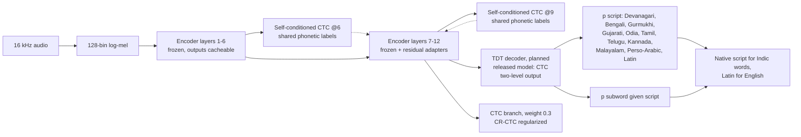

# IndicEAR architecture: design A

Chosen on 23 October 2026 from three designs. The designs came from research into which systems reach the lowest Indic WER, and why. This page is the design as chosen, before any GPU run, kept as written.

**What was actually trained** ([training-recipe.md](training-recipe.md)): the released model is variant `v4+lid`, which uses the two-level output with a **CTC** head, not the TDT decoder drawn below. A factored RNN-T head (`v6`) is implemented but was never trained; TDT is not implemented.

## Design

**Encoder:**
- EmbeddingGemma 2 (`914f7f89`) audio tower, base weights byte-identical.
- The text model (271M) and vision model (167M) are dropped. On 23 October 2026, a linear-CTC probe of the text model's 24 layers over audio tokens, on FLEURS Hindi dev, gave a best CER of 23.3 at layer 1. That is no better than the audio encoder's own 22.6, and the deeper layers lose the sound detail: 37–59 CER at layers 6–21, about 96 at layers 22 and 24, and 50.9 at the output. The model's pooled-embedding training discards what transcription needs. The probe was stopped after Hindi as a project check (`results/probe-eg2text/`).
- Layers 1–6 have no adapters, so their outputs are computed once and cached.
- Layers 7–12 get trainable residual bottleneck adapters, saved as their own file.

**Shared phonetic layer:**
- Self-conditioned CTC at layers 6 and 9 over one transliterated label set for all scripts: ISO 15919 / common-label-set units for Brahmic scripts, Latin for English, romanized Urdu.
- Related languages learn sounds together, which helps spell unseen words.

**Final decoder:**
- TDT with a **two-level output**: the script per token, then the subword within that script.
- Mid-sentence switching (Hindi → Kannada → English) needs no language picker.

**Auxiliary CTC branch:** CR-CTC consistency regularization, plus a fast fallback decode.

**Deliberately left out:**
- An LLM decoder: hallucination, size, poor Indic results.
- An attention decoder: repetition on long audio.
- Language-ID routing: it sends code-switched speech into a single script.

**Language identification as outputs, not routing** (`indicear/lid.py`; trained in the released model, 97.8% utterance accuracy on FLEURS dev):
- Two optional heads report what was spoken. Training never gates, masks or re-weights the transcript by a predicted language. One exception at decode time, on by default: the LID script set (`indicear/decoding.py`, `--lid-script-set`) restricts decoding to Latin plus the scripts of the top-k detected Indic languages. Default k=2, threshold 0.15. Measured gains are in `docs/pilot.md`. By default they read stop-gradient encoder states, so transcription training is unchanged, and with weight 0 the transcript output is bit-identical (tested).
- **Utterance head:** a learned weighted sum of layers 6 and 12 (both computed anyway), attentive mean+std pooling, a small MLP to 12 languages. Cross-entropy with label smoothing and an optional class-balance weight. About 0.40M parameters at width 1024.
- **Frame head:** per 25 fps frame, non-speech plus 12 languages. Monolingual rows label every frame with the utterance language; non-speech negatives label every frame non-speech. Code-mixed rows with per-word languages use CTC over the collapsed language runs ([hi, en, hi]) with non-speech as the blank, so no forced alignment is needed. About 0.27M parameters.
- **Spans:** the frame head's greedy decode gives ordered (language, start frame, end frame) spans; with the transcript's CTC word timings, each word takes its most probable language and spans snap to word boundaries.
- Trainable on top of any variant (`v3+lid`), or alone on the frozen encoder (`lid`).

**Streamed data** (`indicear/stream_train.py`): rows that can't be cached train with `lower="live"`. Each step runs the GPU log-mel and layers 1–6 under `no_grad`, exactly as the cache build does, then layers 7–12 and the heads as usual. The stream's position is saved in the checkpoint.

**Planned additions:**
- **B.** Per-script text LMs with internal-LM-estimation fusion, plus a light rescorer that boosts the user's personal word list.
- **C.** Family adapter experts (Dravidian, Indo-Aryan, English), only if code-switch CER stays poor.

**Known risk:** Hindi and Urdu sound the same, so the script choice may need a per-user preference setting (not a language picker).

## Evidence

| Ingredient | Evidence | Source |
| --- | --- | --- |
| Self-conditioned intermediate CTC | >20% relative WER reduction (WSJ); IBM Granite-speech uses intermediate 0.2 / final 0.8 | arXiv 2104.02724; 2505.08699 |
| CR-CTC consistency regularization | Conformer CTC test-other 7.15 → 5.78 (~19% relative) | arXiv 2410.05101 |
| Shared transliterated labels across Indic scripts | ~6% relative average (up to 10%) | arXiv 2004.09571; IITM common label set, 2210.16739 |
| TDT / multi-blank transducers | Up to 2.82× / 92.9% faster at equal WER | arXiv 2304.06795; 2211.03541 |
| Internal-LM-estimation fusion | 8.1–15.5% relative over shallow fusion; an LM gave ~36% on Indic CTC | arXiv 2011.01991; 2203.16595 |
| Entity / contextual biasing | Gemini 3 Flash 24.3 → 17.5 with native-script entity lists | IndicContextEval, arXiv 2606.19157 |
| Non-speech audio in training | Used to curb hallucination (Canary-1B-v2) | arXiv 2509.14128 |
| int8, not 4-bit | NF4/int3 Whisper lost accuracy on noisy speech; int8 neutral | arXiv 2511.08093 |

## Where the field stands

**Voice of India:** largely independent, 536 h of real phone speech, OI-WER, arXiv 2604.19151.

| System | hi | ta | kn | ml |
| --- | ---: | ---: | ---: | ---: |
| Sarvam Audio | 5.0 | 14.2 | 16.3 | 18.9 |
| Gemini 3 Pro | 6.0 | 15.7 | 19.9 | 21.7 |
| IndicConformer 600M | 8.2 | 19.9 | 21.4 | 26.0 |

**Vaani Hindi benchmark, single reference:** Gemma 4 E2B-IT, which is our encoder with Google's LLM decoder, scores 26.2, against 20.0 for IndicConformer. So the encoder isn't the limit; the decoder and Indic training data are. (The released frozen-encoder model is far behind both, so its gap lies mainly in how much small CTC layers extract from frozen encoder states, not in what the encoder holds; see `docs/full-run.md`.)

**Known failures to avoid:**
- LLM hallucination: 13.2% of Gemma-3N outputs with entity prompts; Whisper produced text for 40.3% of non-speech inputs.
- Attention-decoder repetition on audio over 30 s (Bodhan's own card).
- LID-driven script errors (SraVaani, Whisper on Urdu and Punjabi).
- Overfitting to FLEURS (VoI paper).

**Evaluation rules that follow:**
- Report OI-WER or multi-reference WER plus CER and script-error rate.
- Keep a private held-out set and real code-switch tests.
- Never headline FLEURS.

## Real-world robustness (project requirement)

The requirement: transcribe whatever the user says, including names, rare and new words, slang, Indian-accented English loanwords, dialects, spontaneous speech, noise and phone audio.

**Phonetic layer:**
- The layer-6 CTC uses a **shared phonetic label set**, mapped by rule. Brahmic scripts use an IIT Madras common-label-set / ISO-15919 style mapping; English uses Indian-accent grapheme-to-phoneme variants; Urdu uses a romanization, which loses information.
- Layer 9 adds self-conditioned CTC on the same units, fed back into the next layer.
- Evidence:
  - IITM DuDe: a common label set plus transliteration back to native script beat native-script multilingual training, 27.2 vs 31.5 WER (≈14% relative; Marathi 22.6 → 17.6, Odia 27.9 → 22.4). arXiv 2210.16739.
  - LUPET: phoneme CTC at upper-middle layers, fed back, gave 19.7% relative. arXiv 2401.03689.
- A **hard phoneme-to-grapheme cascade is ruled out**, because errors compound across the stages.

**Open vocabulary:**
- Per script, about 512–1k units made of aksharas plus subwords, with a full character inventory, so any word can be spelled.
- Subword beat word-level vocabularies by 6.2 / 6.6 points absolute in Tamil / Kannada. arXiv 2207.13331.

**Personal dictionary**, fed from the host app's word list, no retraining:
- Entries are transliterated by rule into phonetic units.
- A **CTC word spotter** on the phonetic posteriors detects and replaces spans (arXiv 2406.07096).
- A trie bias on the TDT beams adds 19.5% relative (arXiv 2104.02194).
- Gating prevents over-biasing.
- Matching by sound should recover names with variant pronunciation; phoneme-aware biasing beat spelling-based biasing on rare names (arXiv 2312.09582).

**Robustness training:**
- About 70% spontaneous speech (IndicVoices: 74% extempore).
- Speed 0.9/1.0/1.1, reverberation with point noise, AMR/GSM/Opus codecs, babble, SpecAugment.
- Non-speech negatives.
- GSM codecs and competing speech are the hardest conditions for Indic ASR (arXiv 2606.09335).

**First step, before any training:** measure the frozen encoder by SNR, codec, reverberation and speed bucket. Augmentation only trains the adapters and decoder; a frozen encoder that collapses in some condition cannot be trained out of it.

**Result, 24 October 2026** (`results/pilot-fleurs/robustness-v1/`):
- **Setup:** v1 heads (frozen encoder plus linear CTC, trained on clean FLEURS only), 200 FLEURS dev utterances per language. The noise is synthetic colored noise, not MUSAN, and AMR was skipped because the encoder is missing from Colab's ffmpeg.
- **Mild degradation:**
  - Speed 0.9×/1.1×: about 0 to +1.5 CER.
  - Noise at 20 dB: about +1.5; at 10 dB: about +5; at 5 dB: about +11.
  - Babble at 20 dB: about +2.5; at 10 dB: about +9.
  - 8 kHz telephone: about +6. GSM: about +7, the worst being English 28 → 48. Opus: about +2.
- **Collapses** (CER ×2, or +20 points): 29 language-condition pairs, almost all from reverberation.
  - Reverb RT60 0.6 s plus point noise: 11 of 12 languages.
  - Reverb RT60 0.9 s: 7 languages, e.g. Odia 40 → 78, Urdu 56 → 83, Tamil 36 → 64.
  - Babble at 5 dB: 6 languages.
- **Reading:** noise, codecs and speaking rate look trainable through augmentation of the adapters and decoder. Reverberation is the frozen encoder's weak spot. The pilot must measure how much reverb-augmented adapter training recovers. If it is not enough, the options are dereverberation before the encoder, more far-field and speakerphone training data, or an accepted limitation.

**Metrics:**
- Entity and name recall and NEER.
- Biased vs unbiased word error, and the false-trigger rate with distractor lists.
- OOV-word recall.
- Error rates by SNR, codec and far-field bucket.
- Code-switch span accuracy and script-error rate.
- Lahaja entities, the Svarah everyday split, a Voice of India-style phone set, and Vaani district variety.
