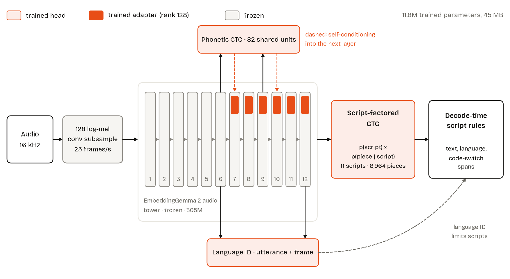
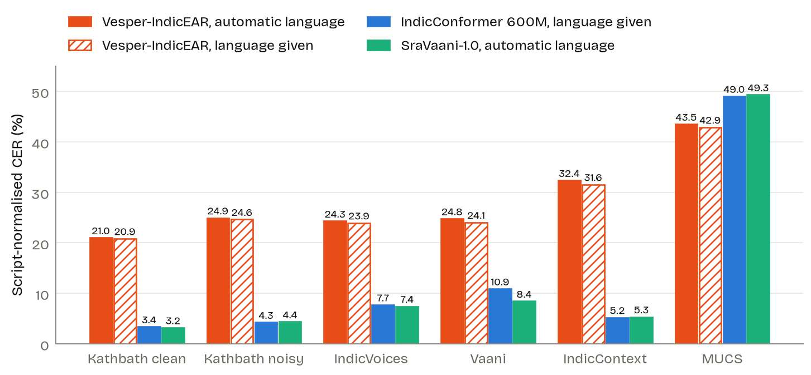
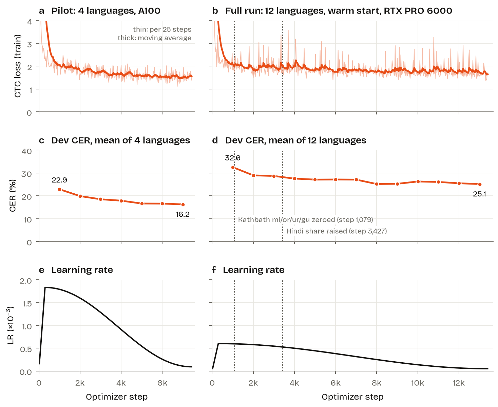

<p align="center">
  
</p>

# Vesper-IndicEAR

Speech recognition for 11 Indian languages and English, part of the Vesper project. It writes each word in its own script, handles code-switched speech, and identifies the language. Built with the IndicEAR framework on the **frozen** audio encoder of EmbeddingGemma 2: only 45 MB of adapters and heads are trained.

**Research release (v0.1).** It works, but its error rate is several times that of dedicated Indic speech models. It is not yet used in the Vesper app.

| | |
|---|---|
| Languages | Bengali, English, Gujarati, Hindi, Kannada, Malayalam, Marathi, Odia, Punjabi, Tamil, Telugu, Urdu |
| Encoder | `google/embeddinggemma-2` audio tower, 305M parameters, frozen (included, unchanged) |
| Trained | 11.8M parameters: adapters on layers 7–12, phonetic CTC, script-factored CTC, language ID |
| Output | Lowercase text without punctuation, language, code-switch spans, word times |
| Download | 627 MiB |
| Licence | Apache-2.0 |

## Architecture

<p align="center"></p>

- The encoder runs unchanged. Small adapters (rank 128) are added to its upper six layers.
- The output predicts the **script** first (one of 11), then the word piece within it, so every word comes out in a definite script.
- A language-ID head reads the encoder. At decode time it limits which scripts may appear, so Hindi speech is not written in Urdu script and vice versa.

## Scripts

Indian languages are written in different scripts (writing systems). The model writes every word in the script its language normally uses, and writes English words in Latin letters, the way people type them:

| Script | Languages | Example |
|---|---|---|
| Devanagari | Hindi, Marathi | नमस्ते |
| Bengali | Bengali | নমস্কার |
| Gurmukhi | Punjabi | ਸਤ ਸ੍ਰੀ ਅਕਾਲ |
| Gujarati | Gujarati | નમસ્તે |
| Odia | Odia | ନମସ୍କାର |
| Tamil | Tamil | வணக்கம் |
| Telugu | Telugu | నమస్కారం |
| Kannada | Kannada | ನಮಸ್ಕಾರ |
| Malayalam | Malayalam | നമസ്കാരം |
| Perso-Arabic | Urdu | آداب |
| Latin | English, and English words inside Indian speech | hello |

So mixed speech such as *"mujhe ye phone bahut pasand hai"* is written as **मुझे ये phone बहुत पसंद है**. The model decides the script of each piece before the piece itself, so a single word never mixes two scripts. Hindi and Urdu share most of their spoken form but are written in different scripts: the model chooses Devanagari or Urdu script from the language it detects, and `lang_hint` lets you choose.

## Results

Script-normalised character error rate (CER, lower is better). Every system transcribes the same 300 clips per language per set; values are means over the 10 Indic languages all three systems support (Urdu excluded), and the Kathbath sets use their unseen-speaker split. Vesper-IndicEAR never saw these sets' speakers in training; the baselines may have trained on some of these sources (IndicConformer on Kathbath's training speakers, SraVaani on Vaani).

<p align="center"></p>

| Test set | Vesper-IndicEAR | IndicConformer 600M | SraVaani-1.0 |
|---|---:|---:|---:|
| Kathbath clean | 21.0 | 3.4 | 3.2 |
| Kathbath noisy | 24.9 | 4.3 | 4.4 |
| IndicVoices | 24.3 | 7.7 | 7.4 |
| Vaani | 24.8 | 10.9 | 8.4 |
| IndicContext (code-mixed) | 32.4 | 5.2 | 5.3 |
| MUCS (Hindi, Bengali) | 43.5 | 49.0 | 49.3 |

English: 7.2 / 13.0 CER on LibriSpeech test-clean / test-other. Language identification: 97.8% of FLEURS utterances. Per-clip transcripts for every system are in [Vesper Indic Bench](https://huggingface.co/datasets/rahulsharmavishwakarma/vesper-indic-bench).

## Examples

Hindi test clips the model never trained on (public, CC BY 4.0), with the model's raw output in automatic language mode. **Bold** marks words that differ from the reference. CER is the clip's character error rate; the set median is over each test set's 3–9 s clips. Most errors are misspelled rare words and English words.

### 1. Read speech

Kathbath · 7.5 s · CER 9.0 (set median 14.3) · detected language: Hindi · [mp3](https://huggingface.co/rahulsharmavishwakarma/vesper-indicEAR/resolve/main/samples/hi_read_kathbath.mp3)

<audio controls preload="none" src="https://huggingface.co/rahulsharmavishwakarma/vesper-indicEAR/resolve/main/samples/hi_read_kathbath.mp3"></audio>

| Reference | Vesper-IndicEAR |
|---|---|
| **रामलाल** कहते हैं किसी तरह **पीड़िता** को मदद मिल गई इसका **उन्हें** संतोष है | **रामल** कहते हैं किसी तरह **पीढ़ता** को मदद मिल गई इसका **उन्हेंने** संतोष है |

### 2. Spontaneous speech

IndicVoices · 8.0 s · CER 10.4 (set median 15.3) · detected language: Hindi · [mp3](https://huggingface.co/rahulsharmavishwakarma/vesper-indicEAR/resolve/main/samples/hi_spontaneous_indicvoices.mp3)

<audio controls preload="none" src="https://huggingface.co/rahulsharmavishwakarma/vesper-indicEAR/resolve/main/samples/hi_spontaneous_indicvoices.mp3"></audio>

| Reference | Vesper-IndicEAR |
|---|---|
| **इसका** मतलब police भी है जो पैसा ही खाता है वो लोग का वो लोग भी उसके पीछे पीछे रहता **है** इस वजह से ये भी एक **अपराध ही** है | मतलब police भी है जो पैसा ही खाता है वो लोग का वो लोग भी उसके पीछे पीछे रहता इस वजह से ये भी एक **अपधी** है |

### 3. Hindi with English words, describing a photo

Vaani · 6.4 s · CER 7.3 (set median 12.5) · detected language: Hindi · [mp3](https://huggingface.co/rahulsharmavishwakarma/vesper-indicEAR/resolve/main/samples/hi_en_photo_vaani.mp3)

<audio controls preload="none" src="https://huggingface.co/rahulsharmavishwakarma/vesper-indicEAR/resolve/main/samples/hi_en_photo_vaani.mp3"></audio>

| Reference | Vesper-IndicEAR |
|---|---|
| इस **फोटो** के अंदर एक बड़ी सी table लगी हुई है जिसके ऊपर कुछ golden colour का colour है और नीचे **पहिए** बने हुए हैं | इस **photo** के अंदर एक बड़ी सी table लगी हुई है जिसके ऊपर कुछ golden colour का colour है और नीचे **पइिया** बने हुए हैं |

### 4. Technical Hindi-English

IndicContext · 7.6 s · CER 18.3 (set median 28.7) · detected language: Hindi · [mp3](https://huggingface.co/rahulsharmavishwakarma/vesper-indicEAR/resolve/main/samples/hi_en_technical_indiccontext.mp3)

<audio controls preload="none" src="https://huggingface.co/rahulsharmavishwakarma/vesper-indicEAR/resolve/main/samples/hi_en_technical_indiccontext.mp3"></audio>

| Reference | Vesper-IndicEAR |
|---|---|
| अब ये **forces** market को काफ़ी **complete** बनाती है जहाँ **differentiation** और cost **का leadership** दोनों **पे pressure होता** है | अब ये **foodurces** market को काफ़ी **comp** बनाती है जहाँ **differenceiiation** और cost **leadersship** दोनों **पर presure** है |

Sources: Kathbath (AI4Bharat), IndicVoices (AI4Bharat), Vaani (ARTPARK-IISc), IndicContextEval (AI4Bharat); all CC BY 4.0.

## Use

```bash
pip install indicear
indicear-transcribe --model rahulsharmavishwakarma/vesper-indicEAR audio.wav
indicear-transcribe --model rahulsharmavishwakarma/vesper-indicEAR --json audio.m4a   # words, times, language
```

```python
from indicear.transcribe import Transcriber

with Transcriber("rahulsharmavishwakarma/vesper-indicEAR") as model:
    result = model.transcribe_file("audio.wav")
    print(result["text"], result["language"]["top"])
```

It runs on CUDA, Apple MPS or the CPU. Long audio is split into 30-second windows automatically. If you know the language, pass it: `model.transcribe(read_audio("audio.wav"), lang_hint="ur")` (`from indicear.transcribe import read_audio`).

## Training

8,356 hours of audio processed, streamed from about 5,500 hours of training pools on the Hugging Face Hub (IndicVoices, Kathbath, Vaani, LibriSpeech, People's Speech, VoxPopuli; CC BY and CC0). A 4-language pilot on an A100 was followed by a 12-language run on one RTX PRO 6000, about 6 GPU-hours.

<p align="center"></p>

The training code, recipe and a Colab notebook are in the [IndicEAR repository](https://github.com/rahulsharmavishwakarma/indicear).

## Limitations

- Accuracy is far below dedicated Indic ASR models; not suitable for production transcription.
- Urdu is often detected as Hindi and written in Devanagari; pass `lang_hint="ur"` when you know it.
- Reverberant, far-field and very noisy audio degrade sharply.
- No punctuation, casing or number formatting; word times are approximate.

## Licence and citation

Apache-2.0. The included EmbeddingGemma 2 audio tower is Google's, Apache-2.0, unchanged. Training data are CC BY (2.0–4.0) and CC0; see the repository's `NOTICE` and `docs/data-licenses.md`.

```bibtex
@misc{vesper_indicear_2026,
  title  = {Vesper-IndicEAR: Indic speech recognition from a frozen embedding-model audio encoder},
  author = {Sharma, Rahul},
  year   = {2026},
  url    = {https://huggingface.co/rahulsharmavishwakarma/vesper-indicEAR}
}
```
